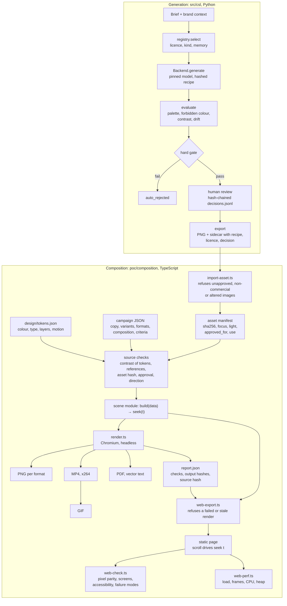

# Architecture: from brief to delivery

Creative Systems Lab has two halves joined by one hand-over file.

1. **Generation** (`src/csl`, Python). A brief goes in. Candidates are generated from a pinned model,
   scored automatically, decided by a person, and exported with their provenance.
2. **Composition** (`poc/composition`, TypeScript). One approved image is placed into a scene written
   as code. The scene is a pure function of time, and every medium is drawn from it: a web page,
   stills, a print PDF, an MP4 and a GIF.

The hand-over is the export sidecar (`<image>.json` next to each exported PNG), which
`poc/composition/src/import-asset.ts` turns into an asset manifest. Nothing else crosses between the
two halves.

## Generation

A run is a directory of plain files: `run.json`, the brief and brand snapshots,
`candidates/<id>/{image.png, manifest.json, evaluation.json}`, `decisions.jsonl`, `integrity.json`,
`report.html` and `export/`. There is no database.

| Concern | Module | What it guarantees, and its limit |
|---|---|---|
| Recipe | `canonical.py`, `schema.py` | `recipe_hash = sha256(canonical JSON)` of model pin, prompt, size, steps and seed |
| Model choice | `registry.py` | selects by licence, kind and memory, and states why a model was excluded |
| Backends | `backends/` | one protocol (`pin()`, `generate()`); local mflux, hosted providers behind a fake transport in tests, a procedural stub |
| Cost | `pricing.py`, `budget.py` | a quote before any paid call; an approved budget reserved atomically and settled after |
| Evaluation | `evaluate.py`, `colour.py`, `drift.py` | colour and tone against numbers in the brand file; it cannot see a wrong subject |
| Review | `review.py`, `integrity.py` | append-only, hash-chained decisions; `verify` detects edits, it does not prevent them |
| Concurrency | `locking.py` | a run lock around every write; export is built aside and swapped in |
| Export | `export.py` | only approved candidates; refuses a non-commercial licence under a commercial brief |
| Replay | `reproduce.py` | regenerates and classifies: `bit_identical`, `perceptually_close`, `diverged`, `pin_mismatch`; a hosted model gives `new_generation` and needs a budget |
| UI | `web/`, `src/csl/web` | a local review UI over the same `review.decide`, loopback only |

## Composition

**The scene contract.** A scene module exports `build(data, imageAspect, host)` and returns
`{ seek(t), measure() }`. `seek` draws the scene at time `t` and nothing else; `measure` returns the
text boxes, safe area and fonts the checks read. Every consumer calls the same two functions:

| Consumer | Calls `seek` | Output |
|---|---|---|
| `render.ts`, stills | once, at the end | PNG per variant and format |
| `render.ts`, film | 30 times per second | PNG frames piped to ffmpeg, then MP4 and GIF |
| `render.ts`, print | once, at the end | PDF with fonts embedded and text as glyphs |
| `web.ts` | from the scroll position | the responsive page |
| `demo.ts` | from a range input | the scrubber in the page's technical section |

**What is data and what is code.** A new campaign, headline, photograph, colour layer or
composition is a change to JSON and an asset manifest. The renderer is not edited. This is tested in
`test/variation.e2e.ts`: three variants in `design/variation.json` change the headline, the image
(a FLUX.2 klein image imported through `import-asset.ts`), the colour layer and the zoom, night and
headline scale, and render without changes to any `.ts` file. The unchanged variant is byte
identical to the base campaign's still.

| Data | File | Read by |
|---|---|---|
| Colour, type, layers, motion | `design/tokens.json` | every scene, the source checks |
| Copy, variants, formats, film and print pairs, criteria | `design/<campaign>.json` | `render.ts`, `web-export.ts` |
| Composition (`zoom`, `night`, `headline`) | campaign or variant | `cinema.ts` |
| Image, focus, light position, approval, directed formats | `assets/<name>.json` | source checks, scenes |
| Technical section prose | `design/explainer.json` | `web-page.ts` |

**Checks, in tiers.** Source checks run before anything is drawn and stop the render on failure:
token contrast pairs, campaign references, asset hash, approval for the medium, and formats each
asset was directed for. Render checks run on every still: fit, safe area, type scale, text off the
photograph's subject, and legibility of each line against the real pixels behind it, sampled every
0,5 s. Reproducibility renders twice from a fresh page and compares bytes. Print checks read the
PDF's fonts. The report links each design criterion to the checks that support it and leaves the
judgement as `pending human review`.

**Web export.** `web-export.ts` refuses unless the last render passed every check, its stills match
the report, and the report's `source_hash` matches the current tokens, campaign, assets, page,
styles and scene modules. The page ships the scene module unbundled with types stripped, one
photograph per screen shape at the density the screen needs, the renderer's poster as a no-script
fallback, and the technical section with facts read from the same report and manifests.

**Film speed.** Frames are captured through the Chrome DevTools Protocol
(`Page.captureScreenshot` with `optimizeForSpeed`) and piped to ffmpeg. That cut the film step from
374,5 s to 118,8 s for three formats, with every MP4 and GIF byte identical to the slower path.
`src/profile-film.ts` measures where frame time goes.

## Trust boundaries

- Hosted model providers are called only by `src/csl/backends`, and only after a quote within an
  approved budget. Keys are read from the environment at call time and never written to a
  record or a file in the repository.
- The renderer aborts every network request that is not the local scene. A render cannot fetch
  anything.
- The share (`share/`, `src/share-worker.ts`) is a Cloudflare Worker that serves the checked export
  unchanged. Its `ACCESS` setting makes it public or puts HTTP Basic authentication in front of
  every request; in that mode the credentials live in the Keychain only.
