# Creative Systems Lab

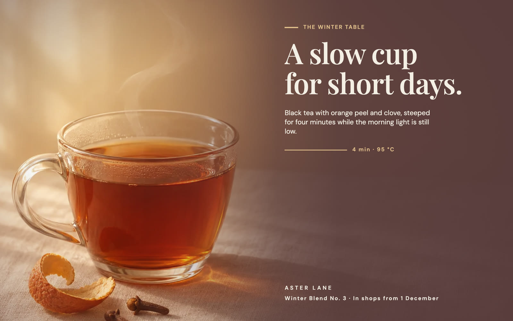

One campaign idea carried through several media by code, starting from a generated image whose
origin and approval are on record.

**Live demo:** <https://csl-winter-morning.tech-a57.workers.dev>. It works on desktop and phone, and
a technical section at the end explains how the page was made.

## The film

[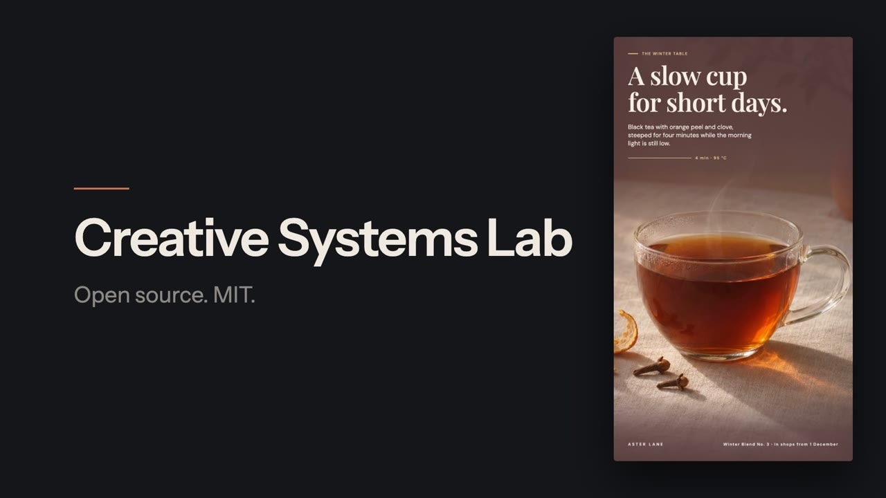](docs/img/csl-launch-film.mp4)

*[Play the launch film](docs/img/csl-launch-film.mp4) (MP4, 41 seconds, with music).* Recorded
headless from the public demo page and from CSL Studio, with no simulated steps: the scroll-driven
page; a brief; four images generated with GPT Image 2.6; each candidate measured against the brand
palette, including one that falls below the limit; a person reading the checks and approving one
image under their name; the design and copy; the formats; the delivery, where all 89 automatic
checks passed; and the finished campaign.

The example is a winter tea campaign for an invented brand, Aster Lane. A generated photograph of a
glass cup in low morning light is placed in a scene written as code. Scrolling the page moves the
scene forward in time: the light warms, the copy arrives, a steeping bar fills and the sender
appears last. The same scene renders the stills, a print PDF, an MP4 and a GIF, and every output is
checked against its own pixels.

## The page

The scroll position is the scene's clock. The opening and the middle of the scroll on a desktop:


On a phone held upright the copy sits above the cup:

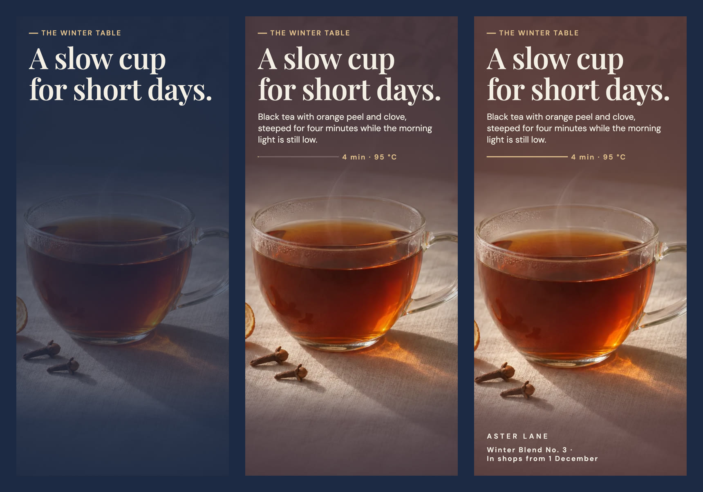


*The live demo scrolled from top to end, recorded headless in Chromium at 1280 × 800. The full
recording is an [MP4 of 9 seconds](docs/img/scroll-recording.mp4).*

## How the page was made

After the film, the page explains itself: the steps from brief to delivery, the recorded
provenance of each photograph, the design tokens, and what the page costs to load.

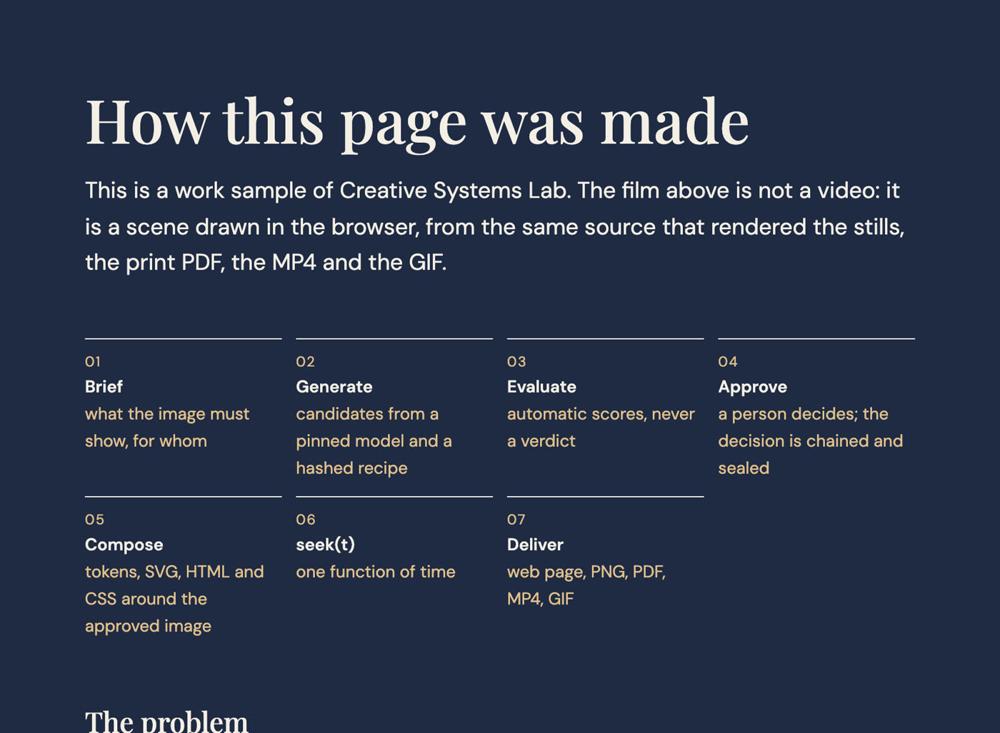

A control in that section draws the same scene function at any moment of the 10-second film, here
t = 3.5 s and t = 9.5 s:

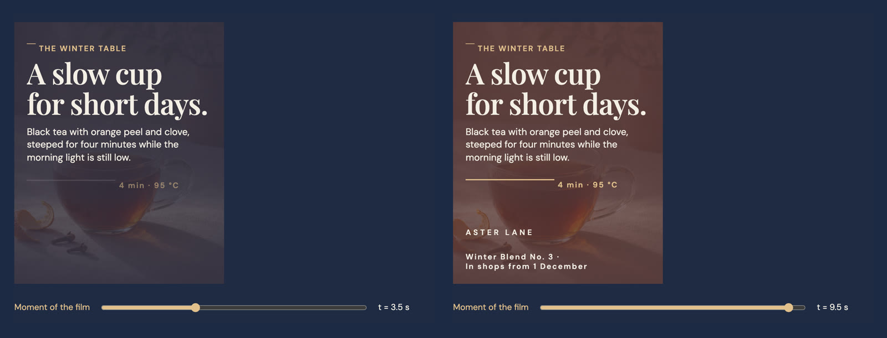

## The studio

Behind the page is a local studio. `csl serve` opens CSL Studio, one workspace per project with
four areas: Brief & brand, Images, Design and Deliver. They can be opened in any order and save as
you go. Images are generated or imported, measured against the brand, and approved or rejected by
a person under their name; the decision stays beside the image. An approved image goes into the
design, which the composition engine previews live and delivers as checked PNG, MP4, GIF and PDF
files.

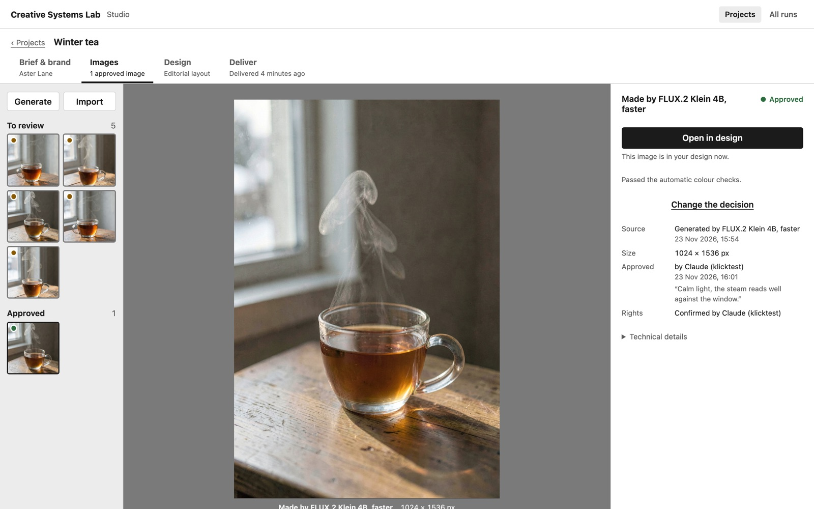

*A project for the same invented brand. The six photographs were generated on this computer with
FLUX.2 Klein 4B, at no cost; one is approved, and the reviewer, the time and the comment stay with
it. [Designer UI](#designer-ui) walks through all four areas.*

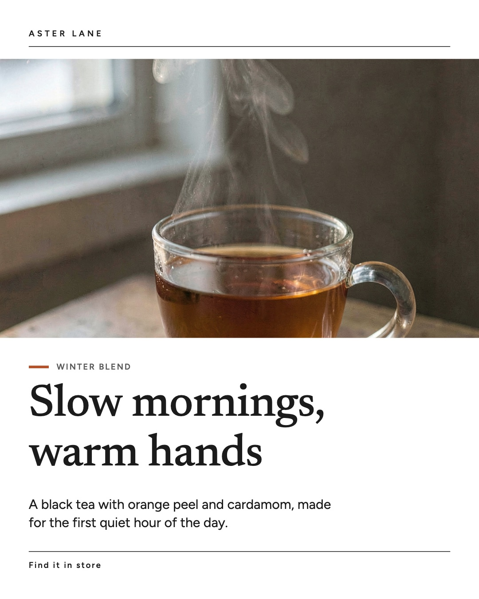

*What the project delivered: the LinkedIn portrait, 1080 × 1350 px, one of three files that passed
all 49 automatic checks.*

Every generation is also a run under **All runs**, with each candidate, the measured checks in
plain language, and a decision appended to the run's sealed log.

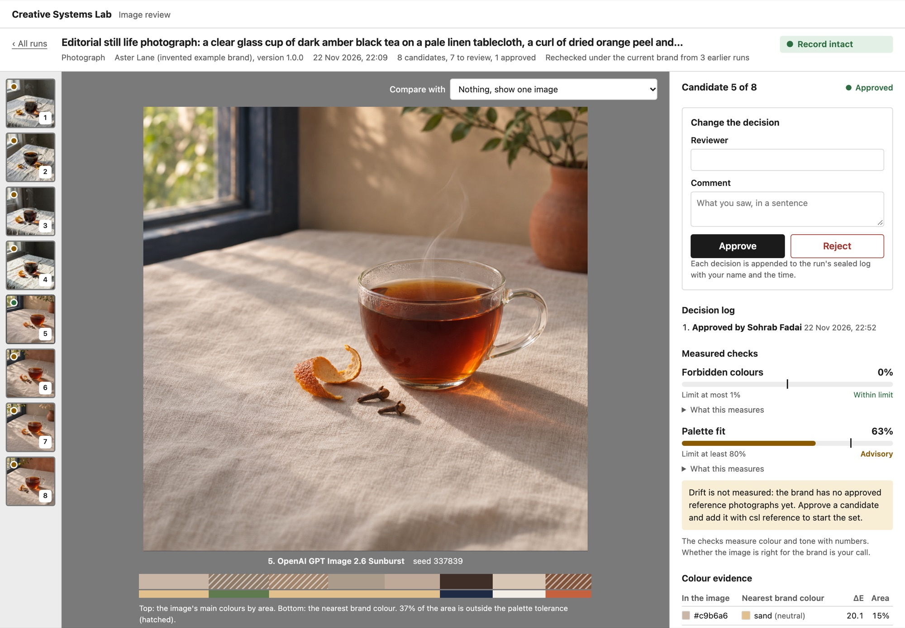

*Candidate 5 of the run that made the photograph on the live page, approved by the project owner.
The decision log names the reviewer and the time, and the record stays intact. The checks are
evidence, not the verdict: palette fit is 63%, below the advisory 80%, and a person approved the
photograph all the same. The GPT Image photographs are not in Git (see
[docs/image-rights.md](docs/image-rights.md)), so this run is not in the repository; the FLUX.2 example
run under `examples/` shows the same review without a key.*

Without a key nothing costs money: on Apple silicon FLUX.2 Klein makes photographs locally, and the
procedural renderer answers illustration briefs. A hosted model needs its provider's key and a spending limit approved under a name, both
set on the Images page. To keep the key out of the browser, let the server ask for it at a hidden
prompt:

```bash
csl serve --ask-key OPENAI_API_KEY
```

The key lives in the server process until you stop it and is never saved or shown. A run that does
not fit the budget is refused before the first call.

## From approved image to finished deliverables

An image reaches the composition only through a human decision, and every later step checks that
decision again instead of trusting the step before it.

1. **Approve.** A person approves a candidate in `csl serve` or with `csl review`. The verdict, the
   reviewer's name, the comment and the time are appended to the run's hash-chained decision log.
2. **Export.** `csl export runs/<run>` writes only approved candidates, each with a sidecar that
   records the image hash, the recipe, the model, its licence and the review decision.
3. **Import.** In `poc/composition`, `node src/import-asset.ts <sidecar> <name> --use feed,story
   --for render,web` refuses anything the pipeline did not approve, any image whose bytes differ
   from the sidecar and any model licence that forbids commercial use. It writes an asset manifest
   that keeps the provenance. Which formats the photograph was directed for (`--use`) and which media
   the approval covers (`--for`) are the designer's choices, so they are arguments.
4. **Compose and render.** `npm run render` places the photograph in the scene written as code. It
   refuses a photograph whose hash differs from its manifest or whose approval does not cover the
   medium, then renders the stills, the print PDF, the MP4 and the GIF and measures each of them.
5. **Publish.** `npm run web:export` writes the static page from the same scene, only from a render
   that passed every check, and only with photographs approved for `web`. The technical section
   reads model, licence, approval and hashes from the manifests, so the page cannot claim more than
   the record holds.

The square photograph on the live page is candidate 5 above, made with GPT Image 2.6 Sunburst. Its
asset manifest (`poc/composition/assets/tea-sunburst.json`) records the project owner's approval for
feed, story, render and web; the landscape photograph has its own manifest and approval.

## What is generated and what is code

| Part | Made by |
|---|---|
| The photograph in each composition | an image model (FLUX.2 klein 4B locally, or GPT Image 2.6), chosen and approved by a person |
| Type, layout per screen shape, light, scrim, grain, timing, motion | code (`poc/composition/src/cinema.ts`) driven by design tokens |
| Copy, variants, formats, design criteria | data written by a person (`poc/composition/design/*.json`) |
| Checks, hashes, reports | code; they support a design decision and never make one |

The code was written with AI assistance (Claude) and reviewed, tested and directed by the project
owner.

## How it is built

A technical work sample in two halves, joined by one hand-over file:

1. **Generation** (`src/csl`, Python). A small, model-agnostic pipeline for brand-governed image
   generation. A brief and a brand context go in; candidates are generated, measured against the
   brand, reviewed by a human, and only approved ones are exported, each with the provenance
   needed to reproduce it.
2. **Composition** (`poc/composition`, TypeScript). An approved image is placed into a scene written
   as code, a pure function of time, and the same scene is drawn as a scrolling web page, stills, a
   print PDF, an MP4 and a GIF. Every output is checked against its own pixels.

Licence: the code and documentation are MIT ([LICENSE](LICENSE)), held by Heartspace PR Sverige AB;
images, recordings, the film, its music and fonts are not, see
[NOTICE.md](NOTICE.md) and [docs/image-rights.md](docs/image-rights.md). The example brand
("Aster Lane") is invented.

- [ARCHITECTURE.md](ARCHITECTURE.md): from brief to delivery, with a diagram
- [docs/case-study.md](docs/case-study.md): the problem, what was built, measured results and limits
- [poc/composition/README.md](poc/composition/README.md): the composition engine in detail

## Problem

Generating one good image is easy. Operating a generator as production infrastructure is not:
the model gets swapped, the weights get updated, prompts get edited, and a month later nobody can
say why last week's banner looked different from this week's, or whether it was ever on brand.
This repository is a vertical slice of the parts that make that tractable:

1. A **recipe** (model pin, prompt, size, steps, seed) that is hashed, so every output can be
   regenerated and the result of regeneration is classified, not assumed.
2. **Models behind one interface** with a registry that selects by licence, kind and memory, and
   states why a model was excluded.
3. **Automated evaluation** of every candidate against the brand (palette, forbidden colours,
   text-zone contrast, drift from approved references), with a hard gate and soft warnings.
4. A **human review step** whose decisions are append-only, and an export that carries
   provenance inside the file.

## Architecture

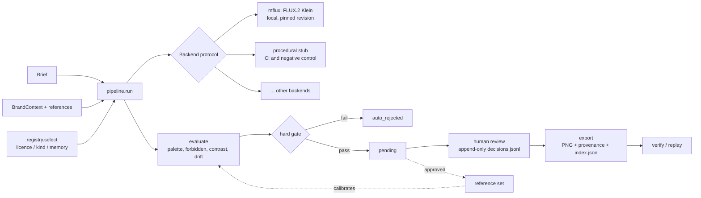

A run is a directory: `run.json`, the brief and brand snapshots, `candidates/<id>/{image.png,
manifest.json, evaluation.json}`, `decisions.jsonl`, `report.html`, `export/`. Nothing is
hidden in a database; everything is plain files that can be diffed and hashed.

### The hard problem: reproducibility you can check

- `recipe_hash = sha256(canonical_json(recipe))`. The recipe includes a **model pin**: backend,
  model id, the Hugging Face cache revision read from `refs/main` of the local cache, and the
  `mflux` and `mlx` versions read from the tool's own interpreter. The child process runs with
  `HF_HUB_OFFLINE=1`, so a silent weight download cannot change what you reproduce.
- `csl verify RUN` checks the whole history: files against `integrity.json`, the hash chain of
  `decisions.jsonl`, evaluations, export sidecars, recipes and images. It detects tampering and
  does not prevent it; see [docs/integrity.md](docs/integrity.md). `csl migrate RUN` seals runs
  made before the chain existed.
- `csl replay RUN CANDIDATE` regenerates from the stored recipe and reports one of
  `bit_identical`, `perceptually_close` (dHash distance at most 6 bits **and** mean Lab colour difference at most 6.0 dE; the limits are set, not validated), `diverged`, or
  `pin_mismatch` (the installed weights or tools no longer match the pin; it refuses unless
  forced). For a hosted model it reports `new_generation`: the providers do not reproduce an image
  from a request (OpenAI's image API takes no seed), so the call is a new paid image, refused
  without `--budget`, and never reported as a reproduction.

Measured on this machine (M4 Max, 48 GB, mflux 0.19.2, mlx 0.32.2): replaying
`flux2-klein-4b-q8-s636537` and `flux2-klein-4b-q4-s636536` returned `bit_identical`. That is a
property of this hardware and software stack, not a general claim; the pin mismatch path exists
because it will not hold across machines or versions.

### Evaluation

Described in [docs/evaluation.md](docs/evaluation.md). The checks measure colour and tone
against numbers; they do not measure whether an image follows a brand. In short: palette fit (dominant colours,
CIE76 in Lab, area weighted), forbidden-colour area, WCAG contrast of the planned overlay text
over a reserved zone (5th percentile), and drift against approved references (Lab histogram
Jensen-Shannon distance plus tone z-scores) with a threshold calibrated by leave-one-out on the
reference set. Palette, forbidden colour and contrast are hard gates; the two drift checks are
soft warnings because the methods are experimental. Thresholds live in the brand file, not in code.

## What is implemented and tested

| Area | State |
|---|---|
| Recipe hashing, manifests, verify, replay with four outcomes | implemented, tested, replay confirmed on real model |
| Backend protocol; `mflux` backend (FLUX.2 Klein 4B q8/q4, 9B q6) | implemented; 4B run for real, 9B registered only (not run in this work) |
| Hosted backends: OpenAI GPT Image 2.6, Gemini Nano Banana, xAI Grok Imagine, BFL FLUX, ElevenLabs | implemented, tested against a fake transport; OpenAI GPT Image 2.6 Sunburst called for real (six images, 0,34 USD), the others not |
| Price table, `csl quote`, approved budgets with a reserve/settle ledger | implemented, tested |
| Procedural backend (SplitMix64 shapes) | stub and negative control, **not a generative model** |
| Registry with licence, kind and memory rules and stated reasons | implemented, tested |
| Evaluation: palette, forbidden, contrast, drift, tone | implemented, tested |
| Review with append-only log, override requires a note | implemented, tested |
| Export with embedded provenance, commercial-licence guard | implemented, tested |
| Static HTML report, model comparison | implemented |
| Designer UI (local API + React, approve/reject via the same chained backend) | implemented, end-to-end tested in headless Chromium |
| Studio: projects, brands, uploaded fonts, generate, review, design with live preview, delivery as PNG, MP4, GIF and PDF | implemented; the PNG path end-to-end tested in headless Chromium with the downloaded file checked byte by byte, and every area checked at phone width; for film and print only the request to the engine is tested, not the finished MP4, GIF or PDF |
| Blind validation harness (40 fictional-brand cases, rating view, FP/FN report) | built; **ratings not done, no result claimed** |
| Video from a generative model | not implemented; films are rendered from an approved still by the composition engine |
| Learned quality metrics (CLIP, aesthetic scores) | not implemented |

Tests: `pytest` collects 217 tests; 216 run offline. The one that calls a real model is marked `mflux`
and skips when the tool is absent (it passed with the tool present). The composition engine has its
own tests, below.

## Reproduce

```bash
python3 -m venv .venv && . .venv/bin/activate
pip install -e ".[dev]"
scripts/check.sh            # ruff check, ruff format --check, mypy (strict), pytest

# Offline, no model needed: the procedural stub and its off-brand negative control
csl models --brief examples/aster-lane/brief.json
```

With a local FLUX.2 Klein setup (this was run with `mflux` in a separate venv and the
`black-forest-labs/FLUX.2-klein-4B` weights already in the Hugging Face cache; nothing is
downloaded by this repository):

```bash
export CSL_MFLUX_BIN_DIR=/path/to/venv/bin      # directory containing mflux-generate-flux2
scripts/run_example.sh
csl review RUN CANDIDATE approve --reviewer you --note "why"
csl export RUN && csl verify RUN
csl replay RUN CANDIDATE
csl compare RUN
```

## Real output

The committed run is `examples/aster-lane/results/aster-tea-banner-20261122T061057/`. It was
generated by this system with FLUX.2 Klein 4B (Apache-2.0), 320x320, 8 steps; decisions were made
by a demo reviewer. `csl verify` on it prints `intact`.

```
flux2-klein-4b-q4  n=3 hard_pass=3 approved=1 colour_drift=0.452 mean_s=8.9
flux2-klein-4b-q8  n=3 hard_pass=3 approved=1 colour_drift=0.417 mean_s=8.2
procedural-offbrand n=3 hard_pass=0 approved=0 colour_drift=0.895 mean_s=0.0
```

Timings include model load per image (the tool is invoked once per image). The off-brand stub is
rejected on forbidden-colour area and palette fit (hard) and also trips both soft drift warnings. A second run (photo
style brief, not committed) was auto-rejected for palette fit on all three candidates, as it
should be against an illustration-only reference set; see limitations below.

## Tradeoffs and limits

- **The reference set is the reviewer's own taste, frozen.** Four references from one model is
  too few to say anything about brand correctness; drift measures consistency with what was
  approved. Below 3 references the drift check reports itself as uncalibrated.
- **The drift histogram resolution (3x3x3 Lab bins) was chosen by looking at the five generated
  images and the off-brand stub.** It separates them here; it has not been validated on
  anything else. Treat it as tuned on a toy set.
- Palette and contrast checks are cheap and explainable, not perceptual quality. They will not
  catch a malformed hand or a wrong object. Human review is the actual quality gate.
- 320 px images are used because they are fast; they are not representative of production
  resolutions, and results at 1024 px were not measured.
- Bit-identical replay was seen on one machine. Other hardware, a different mlx version or
  different weights will diverge, and the pin check says so instead of pretending.
- One image per process invocation is simple and robust but pays model load every time.

## What production would need

A job queue and a long-lived model server instead of one process per image; storage with
retention for runs; reviewer identity and auth rather than a name string; a larger, versioned
reference set per brand with calibration tracked over time; learned metrics next to the rule
based ones, validated against human decisions; video backends and temporal consistency checks;
integration with the brand's real asset system. Image-size and resolution sweeps. A decision on
licence and on whether FLUX.1-dev class models are permissible for the intended use.

## Code quality

Everything is typed and linted with no blanket ignores and no inline suppressions:

```bash
ruff check .            # select = ["ALL"], a short documented ignore list in pyproject.toml
ruff format --check .
mypy                    # strict, pydantic plugin
pytest -q
```

`scripts/check.sh` runs exactly these plus the frontend checks (below) and CI (`.github/workflows/ci.yml`) calls that script on
Python 3.11 and 3.13. The ignore list contains only rules that conflict with each other or with
the formatter, plus a few per-file exceptions (subprocess use in the mflux backend, asserts in
tests), each commented in `pyproject.toml`.

## Designer UI

```bash
(cd web && npm ci && npm run build)
csl serve            # http://127.0.0.1:8765
```

**CSL Studio.** The start page is one workspace per project, with four areas that can be opened in
any order and that save as you go:

The screenshots below follow one project, "Winter tea" for a made-up brand, Aster Lane, from brief to
files. The photographs in them were generated on this computer with FLUX.2 Klein 4B, at no cost.

- **Brief & brand**: what the image should show, and a brand (colours, two typefaces, a style note,
  reference images) that is saved once and reused by every project. Eight open-licence fonts are
  bundled; a font file of your own can be uploaded under a name once you confirm its licence.

  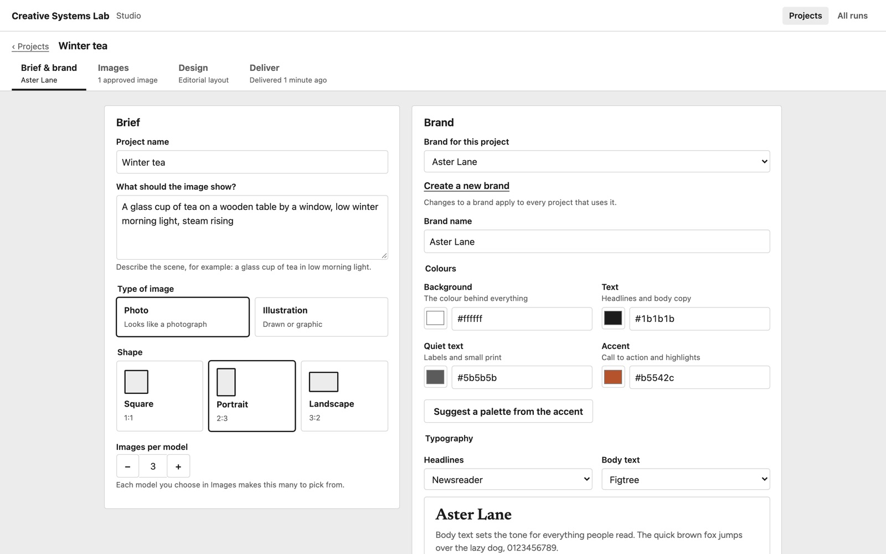

  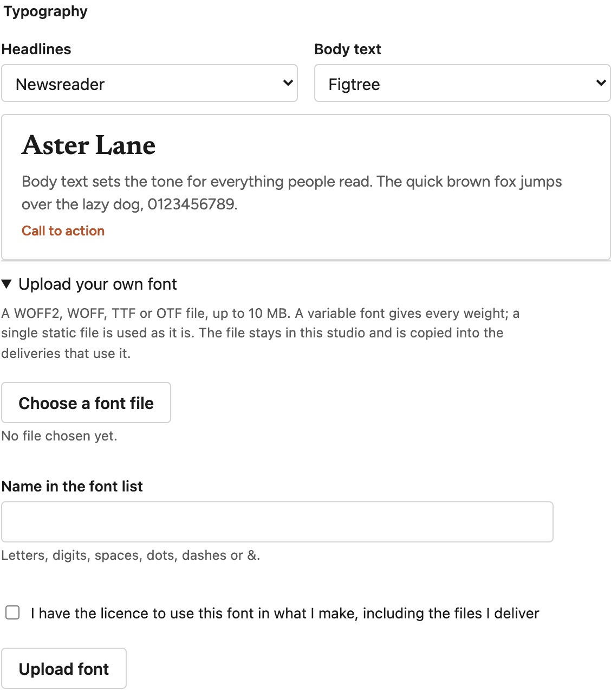

- **Images**: generate with the models that may serve the brief, or import your own photographs.
  Each image is approved or rejected under the reviewer's name; an imported image also needs the
  reviewer to confirm the right to use it. **Use in design** puts an approved image in the design,
  and the decision behind it stays visible.

  

- **Design**: a live preview drawn by the composition engine itself, in every size. Headline, body,
  label, call to action, sender, image, crop (the point that must stay in view, and zoom), layout
  (editorial or cinematic), headline size and, for the cinematic layout, how dark the film starts.

  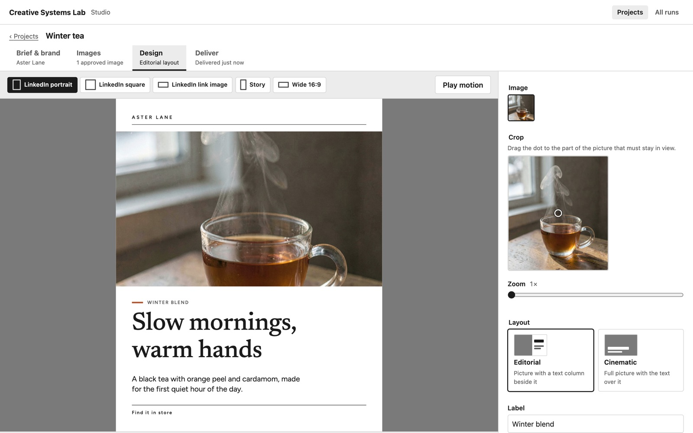

- **Deliver**: PNG for LinkedIn (portrait, square, link image) and for story and 16:9, plus MP4, GIF
  and PDF on request. Every file is checked by the engine before it is offered; preview, download
  one, or download all as a zip. A design whose text would be too faint is stopped before rendering,
  with the colour to change named.

  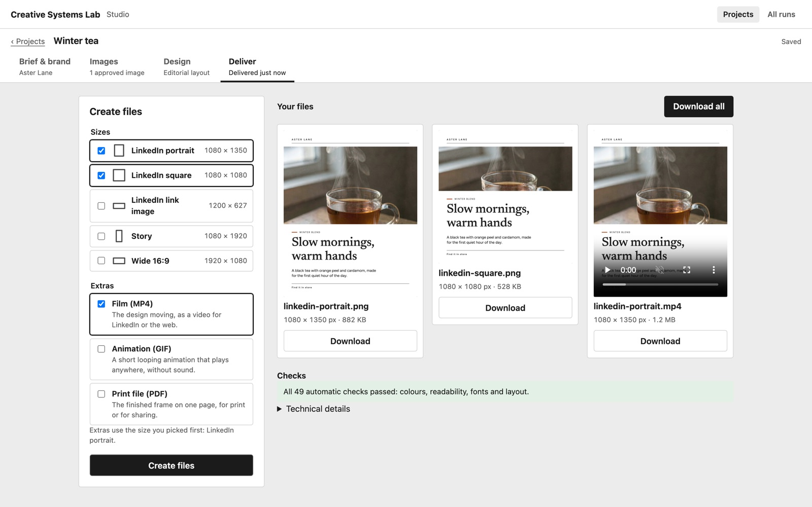


A paid model needs its provider's key and a spending limit. Both are set on the Images page and
take effect at once; the limit is approved under a name, saved in `studio/budgets/` and used again
the next time the studio starts (`--budget <file>` overrides it).

A key pasted on the Images page is kept only by the studio program running on this computer, in
its memory. It is not saved to disk, is never shown again, and leaves the computer only for the
provider when you generate; it is gone when the studio stops. Each provider shows whether its key
was pasted here or came from the terminal. **Keep the key in your terminal instead** gives copyable
commands for the chosen provider: `csl serve --ask-key`, the macOS Keychain, or a password manager
that sets environment variables.

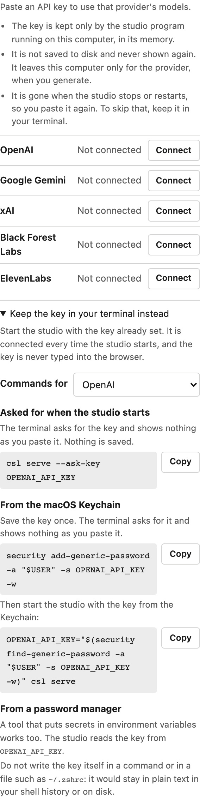


Brands and projects are kept in `studio/` (ignored by Git); `--studio <dir>` keeps them elsewhere.
Rendering needs Node 24 with the engine's dependencies installed (see below) and `ffmpeg` for film.

With no key the procedural renderer answers every illustration brief at no cost. To try a hosted
model with your own key, approve a spending limit in a file (`budgets/` is ignored by Git) and let
the server ask for the key:

```bash
mkdir -p budgets
echo '{"id": "first-budget", "approved_usd": 5, "approved_by": "Your Name", "approved_on": "2026-11-22"}' \
  > budgets/first-budget.json
csl serve --budget budgets/first-budget.json --ask-key OPENAI_API_KEY
```

Paste the key at the prompt. Nothing is shown, so the key stays out of the terminal, the shell
history and any screen you share or record, and it is not saved: it lives in the server process until
you stop it. The start panel then shows the price per image, what the run will hold, and what is
left; a run that does not fit is refused before the first call. The page only says whether the key is
set. On a Mac, `scripts/with-keys.sh csl serve ...` reads stored keys from the Keychain instead.

Brief, candidates beside references, plain-language check explanations, approve or reject with a
comment, and the blind rating view. See [docs/web-ui.md](docs/web-ui.md). The frontend is held to
TypeScript strict (with `noUncheckedIndexedAccess`), ESLint `strictTypeChecked` and no
suppressions; `scripts/check.sh` also builds it and runs the six Playwright tests.

## Composition engine

Needs Node 24 or later (types are stripped natively). Its dependencies are declared in
`poc/composition/package.json` with their own lockfile. Film and print also need ffmpeg and poppler
(`pdffonts`); `FFMPEG` and `PDFFONTS` override the binaries' paths. CI runs the first four commands
below on every push.

```bash
cd poc/composition
npm ci && npx playwright install chromium
npm run typecheck && npm run lint && npm test      # strict TypeScript, ESLint, 50 unit tests
npm run test:demo                                  # fresh-clone chain: import, render, 41 checks, ~15 s
npm run test:variation                             # data-only variants render without code changes
npm run render:stills                              # stills and every check, about 45 s
npm run render                                     # plus MP4, GIF and PDF, about 3 min on an M4 Max
npm run web:export && npm run web:check            # the web page, and its parity with the render
npm run web:perf                                   # load, frames, CPU and heap; needs a GPU
```

`test:demo` needs no keys and no file outside Git: it imports the approved FLUX.2 klein image
(Apache-2.0) from the committed pipeline export in `examples/`, renders one still of
`design/demo.json` and requires every check to pass, two identical renders included.

The winter-morning campaign is the main visual example. Its two GPT Image 2.6 photographs are not
in Git (only their manifests are; their terms are in [docs/image-rights.md](docs/image-rights.md));
without them the source checks stop the render with a message naming the missing
file. The variation test also needs them.

**Your own campaign.** Bring an image approved in the pipeline (`csl export` writes the sidecar),
import it with `node src/import-asset.ts <sidecar.json> <name> --use feed,story,landscape --for
render,web`, copy `design/demo.json` with your copy, formats and asset, and render it with
`node src/render.ts design/<yours>.json`. The web page needs a format for each screen shape (wide,
medium and tall), an image approved for `web`, and a render whose checks all passed.

## Docs

- [docs/case-study.md](docs/case-study.md): problem, architecture, results, limitations
- [docs/interfaces.md](docs/interfaces.md): what another application may rely on: the command line, the local API, the export sidecar and the composition engine; versions in [CHANGELOG.md](CHANGELOG.md)
- [docs/image-providers.md](docs/image-providers.md): local and hosted image models, prices, budgets
- [docs/image-rights.md](docs/image-rights.md): who holds the generated images, under which terms, apart from the code licence
- [docs/design-rhetoric.md](docs/design-rhetoric.md): design criteria from visual rhetoric (kairos, ethos, pathos, logos)
- [docs/web-ui.md](docs/web-ui.md): the designer UI, security notes, dependency licences
- [docs/validation.md](docs/validation.md): blind rating of the quality judgement (waiting for ratings)

- [docs/evaluation.md](docs/evaluation.md): how each check works and what it cannot see
- [docs/integrity.md](docs/integrity.md): what `verify` proves, and the limits of a local hash chain
- [docs/models-and-licences.md](docs/models-and-licences.md): models, licences, hardware limits
- [docs/inventory.md](docs/inventory.md): where this came from and what was reused
- [OPEN-SOURCE-CHECKLIST.md](OPEN-SOURCE-CHECKLIST.md): what was checked before this repository was opened, and what remains
