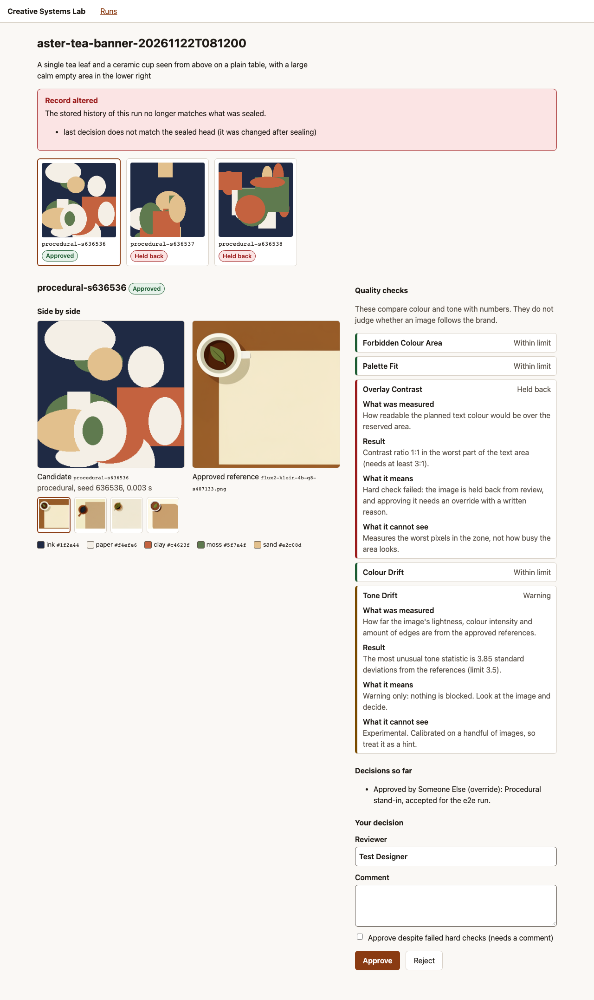

# Integrity of a run: what `csl verify` proves and what it does not

A run is a directory of plain files. `csl verify RUN` checks the whole history, not only the
images.

## What is recorded

- `decisions.jsonl` is a **hash chain**. Every line carries `prev_hash`, the SHA-256 of the
  previous line as stored (the first line carries 64 zeros). Changing, removing or reordering a
  line breaks the chain from there on.
- `integrity.json` is a **manifest**:
  - `generated`: SHA-256 of `run.json`, `brief.json`, `brand.json`, `selection.json` and every
    file under `candidates/` (images, `manifest.json`, `evaluation.json`). Written once, when
    generation ends. A later decision does not rewrite it, so a tampered `evaluation.json`
    cannot be legitimised by making another decision.
  - `exported`: SHA-256 of every file under `export/` (PNGs, JSON sidecars, `index.json`),
    written when the export is written.
  - `decisions`: number of decisions and the hash of the last line, advanced by each decision.
    The chain alone cannot see that the newest lines were cut off; this can.
- `report.html` is derived output and is not sealed; `csl report` regenerates it.

## What `verify` reports

Changed, missing and unexpected files (with the path), a broken chain (which decision and why),
a decision log shorter or longer than sealed, a last decision that was edited, decisions that
refer to a candidate that does not exist, plus the older checks (recipe hash, brief and brand
snapshots, image hash, export index). `csl review` and `csl export` refuse to extend a run whose
chain is already broken.

The review interface runs the same `verify` on every load. After one decision row was edited on
disk, it shows what changed and refuses further decisions:

## What it does not do

A hash chain in a local file **detects** manipulation. It does **not prevent** it. Whoever can
write the run directory can edit a decision, recompute every later `prev_hash`, and rewrite
`integrity.json` to match; `verify` will then pass. Closing that gap needs something outside the
directory that the attacker cannot rewrite, for example:

- the head hash (and decision count) signed with a key the reviewer holds, or
- the head hash published or timestamped in another system (a transparency log, a trusted
  timestamping service, a commit in a repository with protected history), or
- review decisions written to a service with its own access control.

None of this is built here. Reviewer identity is also only a name string: the chain says the
record was not edited, not who made the decision.

## Runs made before this existed

`csl verify` on such a run succeeds with a warning that decisions, evaluations and sidecars are
not verified. `csl migrate RUN` chains the existing decision log and seals the **current**
state (`origin: "migrated"` in the manifest; `verify` keeps warning that it is attested only as
of migration). It cannot show that nothing changed before migration. Until a run is migrated,
`csl review` and `csl export` refuse to write to it.
