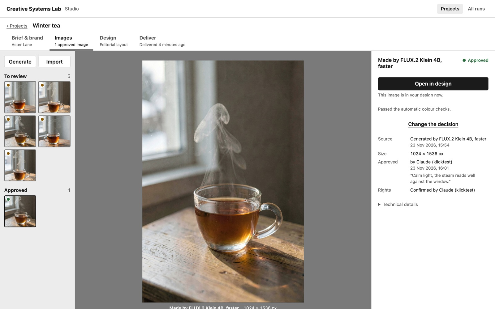
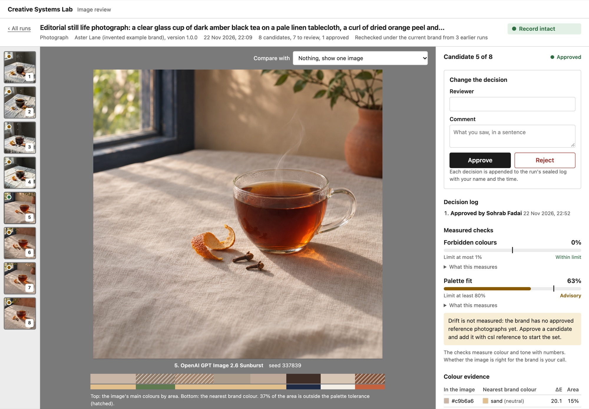

# Designer UI

`csl serve` opens CSL Studio: one workspace per project with four areas, Brief & brand, Images,
Design and Deliver. The README's [Designer UI](../README.md#designer-ui) section walks through
them with screenshots of one project; the run review described below is still under **All runs**.



## Where a provider key is kept

A key pasted in the studio is held in the memory of the `csl serve` process on this computer. It is
not written to disk, not returned by the API, and sent only to that provider when you generate. It
is gone when the server stops. `GET /api/setup` reports for each provider whether a key is set and
whether it was pasted in the studio (`studio`) or was in the server's environment at start
(`terminal`), never the value. The panel's **Keep the key in your terminal instead** shows the
commands for `--ask-key`, the macOS Keychain and a password manager, filled in for the chosen
provider.

## Fonts

Eight open-licence families are bundled (see [NOTICE.md](../NOTICE.md)). A WOFF2, WOFF, TTF or OTF
file of up to 10 MB can be uploaded under a family name once the uploader confirms the licence. It
joins every brand's font list in that studio and is copied into the deliveries that use it.

## Run review

A small local web app over the existing backend. No login, no cloud service, no platform: a thin
Python HTTP API (standard library `http.server`) and a Vite + React + TypeScript frontend.

```bash
(cd web && npm ci && npm run build)
csl serve            # http://127.0.0.1:8765
```

## What it does

- Runs list, and a form to start a run: brief, candidates per model, models grouped as local or
  hosted with their price per image, and a summary of what the run holds from the budget before it
  starts. Models that cannot run here are folded away with the reason (key not set, no spending
  limit, not installed, wrong kind). Jobs run one at a time and are polled.
- A setup panel: which local models are installed, which provider key variables are set (never
  their values), and the approved budget, with the steps to add a key or a budget.
- Run detail: brief, brand palette, verification banner, candidate grid, each candidate beside an
  approved reference, and each quality check explained in plain language (what was measured, the
  result, what it means, what it cannot see). Hard failures are labelled "held back", soft ones
  "warning".
- Approve or reject with a reviewer name and a comment. Approving a candidate that failed a hard
  check needs the override box and a comment, as in the CLI.
- Blind rating view, see [validation.md](validation.md).



## Decisions use the CLI's logic

The API calls `csl.review.decide`, the same function as `csl review`. So the hash chain, the
manifest and the refusal to extend a broken run are identical. The UI re-runs `verify` on every
load and shows the result; see [integrity.md](integrity.md) for what a changed record looks like.

The end-to-end test (`web/e2e/review.spec.ts`, headless Chromium) starts a run through the UI,
approves a candidate, checks that `csl verify` passes, then edits the decision row on disk and
checks that both `csl verify` and the UI report the change.

## Security notes

The server binds to 127.0.0.1 only, rejects requests whose Host header is not loopback (DNS
rebinding), requires `application/json` on POST, validates ids against strict patterns, and has
no authentication. Anyone who can reach the loopback port can approve images; it is a single-user
tool.

## Accessibility

Text and control colours were computed against their backgrounds: at least 6.0:1 in the light
theme and 8.2:1 in the dark theme for every pairing used (AA needs 4.5:1). Candidates form a radio
group with arrow keys, focus is always visible, there is a skip link, motion respects
`prefers-reduced-motion`, and no external fonts or scripts are loaded. This was checked by
computation and by the keyboard e2e test, not with a screen reader or an automated audit.

## Frontend quality gates

TypeScript `strict` with `noUncheckedIndexedAccess` and `exactOptionalPropertyTypes`; ESLint
`strictTypeChecked` and `stylisticTypeChecked` plus `react-hooks`, `--max-warnings 0`, no disable
comments and no `any`. API responses are `unknown` until a hand-written decoder has checked them.

## Dependencies and licences

Shipped in the bundle: React 19.3.1 and react-dom 19.3.1 (MIT), with scheduler 0.28.0 (MIT).

Build and test tooling only, exact versions pinned in `web/package.json`: vite 8.3.8, @vitejs/plugin-react 6.3.0,
eslint 10.15.0, @eslint/js 10.0.1, typescript-eslint 8.73.0, eslint-plugin-react-hooks 7.1.1,
globals 17.14.0, @types/react, @types/react-dom and @types/node (all MIT); typescript 6.0.3 and
@playwright/test 1.65.1 (Apache-2.0).

The lockfile holds 195 packages. Licence field counts: MIT 143, Apache-2.0 18, ISC 10, BSD-2-Clause
6, BSD-3-Clause 2, BlueOak-1.0.0 2, 0BSD 1, MPL-2.0 12, CC-BY-4.0 1. The MPL-2.0 packages are
`lightningcss` and its per-platform binaries, pulled in by vite; they are used unmodified at
build time and are not part of the shipped bundle. The CC-BY-4.0 package is `caniuse-lite`
(browser data used at build time, attribution to the Browserslist authors). Neither ends up in
what the app serves.

TypeScript is pinned to 6.0.3 because typescript-eslint 8.73.0 supports TypeScript below 6.1.
